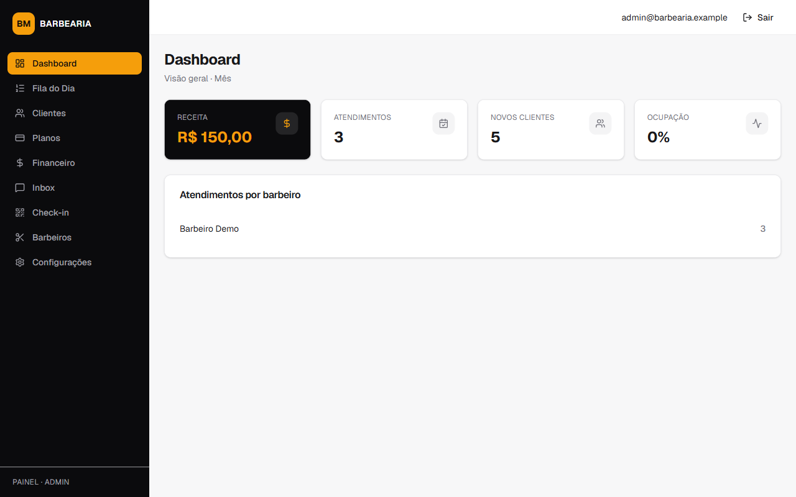
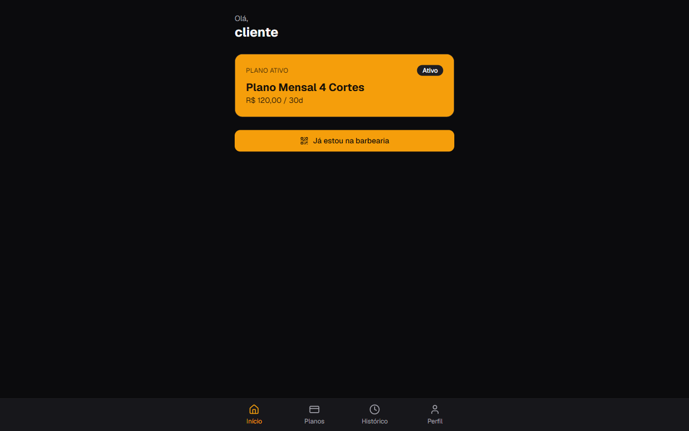

# Barbearia

Sistema para barbearia que atende por ordem de chegada. O cliente chega, faz check-in mostrando um QR Code no celular e entra na fila. A equipe acompanha a fila, chama o próximo, finaliza o atendimento e vende planos de assinatura pagos por PIX. As conversas de WhatsApp e Instagram caem numa caixa de entrada só, com IA para responder o básico. Uma única API atende várias barbearias ao mesmo tempo, cada uma isolada da outra.

São três apps neste repositório:

- **API** (`apps/api`): NestJS, Prisma, PostgreSQL, Redis com BullMQ e Socket.IO. Toda a regra de negócio mora aqui.
- **Painel** (`apps/painel`): Next.js para a equipe (dono, gerente, barbeiro). Fila, clientes, planos, financeiro, caixa de entrada e check-in.
- **Cliente** (`apps/cliente`): Next.js para o cliente. Gera o QR Code de check-in, vê planos, histórico e perfil.

## Telas

Painel da equipe, logo depois do login:



App do cliente, tela inicial:



## Como rodar

Precisa só de Docker com o Compose.

```bash
git clone <url-deste-repositorio> barbearia && cd barbearia
cp .env.example .env
docker compose up --build
```

Na primeira vez demora alguns minutos para montar as imagens. O compose sobe Postgres e Redis, aplica as migrations, roda o seed com dados de exemplo e só então libera o painel e o cliente.

| O quê | Endereço |
|---|---|
| Painel | http://localhost:3001 |
| Cliente | http://localhost:3002 |
| API | http://localhost:3000 (saúde em `/health`, Swagger em `/docs`) |
| Postgres | localhost:5433, usuário e senha `barber` |

Para parar: `docker compose down`. Para zerar o banco também: `docker compose down -v`.

## Login de teste

Essas senhas existem só no seed, para ambiente local. Não use em produção.

| Onde | E-mail | Senha |
|---|---|---|
| Painel, dono | admin@barbearia.example | admin123 |
| Painel, barbeiro | barbeiro@barbearia.example | admin123 |
| App do cliente | cliente@barbearia.example | Cliente123 |

O seed cria a Barbearia Modelo (slug `barbearia-modelo`) com cinco clientes, fila com gente esperando e em atendimento, três planos, assinaturas em vários estados, pagamentos de exemplo e conversas de WhatsApp e Instagram.

## Integrações externas ficam desligadas

O `.env.example` não tem nenhuma chave real.

- **Mercado Pago**: vem com um token falso de teste. O painel mostra os pagamentos do seed, mas gerar uma cobrança PIX nova só funciona se você colocar um token de sandbox seu (`TEST-...`) em `MERCADO_PAGO_ACCESS_TOKEN`.
- **WhatsApp** (Evolution API): sem `EVOLUTION_API_KEY` a API recusa os webhooks e não envia nada.
- **Instagram** e **IA** (OpenAI): sem `INSTAGRAM_PAGE_ACCESS_TOKEN` e `OPENAI_API_KEY` ficam inativos.

## Estrutura

```text
barbearia/
  apps/
    api/        API NestJS (prisma/, src/, test/, specs/)
    painel/     painel da equipe (src/, e2e/, specs/)
    cliente/    app do cliente (src/)
  docs/
    constituicao/   princípios da API e do painel
    prints/         imagens deste README
  docker-compose.yml
  .env.example
  AGENTS.md         regras para quem (pessoa ou agente) for mexer no código
```

Cada app tem o próprio `package.json` e `package-lock.json`. Não há workspaces: para trabalhar num app, entre na pasta dele e use `npm install` e os scripts de lá. As specs de cada feature ficaram dentro do app a que pertencem (`apps/api/specs`, `apps/painel/specs`).

## Decisões principais

- **Ordem de chegada, sem agendamento.** A barbearia funciona por walk-in. Não existe agenda com horários: a fila é a lista de atendimentos `AGUARDANDO` em ordem de criação, e o bot informa e direciona, mas não marca horário.
- **Várias barbearias numa API (multi-tenant).** Toda tabela tem `tenant_id`, toda consulta filtra por ele e o tenant vem do token JWT. Vazar dado de uma barbearia para outra é tratado como falha de segurança.
- **A API é o centro.** Painel, cliente, WhatsApp, Instagram e IA só falam com a API. Ninguém acessa o banco além dela, nem a IA.
- **Efeito colateral vai para fila.** Mandar mensagem pós-atendimento, pedir avaliação ou oferecer plano roda em jobs do BullMQ, com retry, e nunca trava a requisição.
- **Check-in por QR Code de vida curta.** O cliente gera um token opaco que vale 60 segundos e é guardado no Redis; a equipe lê e o cliente entra na fila. Gerar um novo invalida o anterior.
- **Pagamento pelo gateway.** A API cria a cobrança no Mercado Pago e confirma por webhook com assinatura validada e processamento idempotente. Cartão nunca passa pela API.
- **Sessão em cookie httpOnly nos fronts.** O navegador fala só com as rotas `/api/*` do próprio Next, que repassam para a API. O token não fica exposto ao JavaScript da página.

Os detalhes estão em `docs/constituicao/` e nas specs de cada app.
