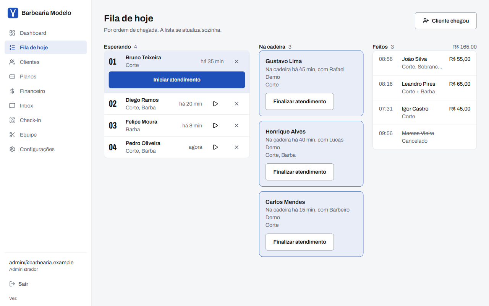
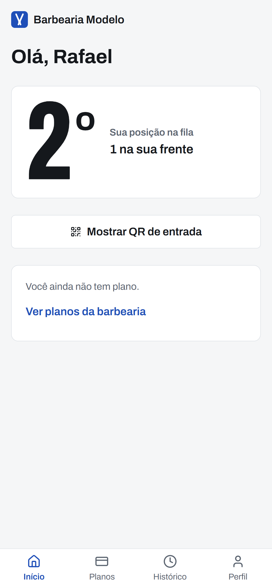
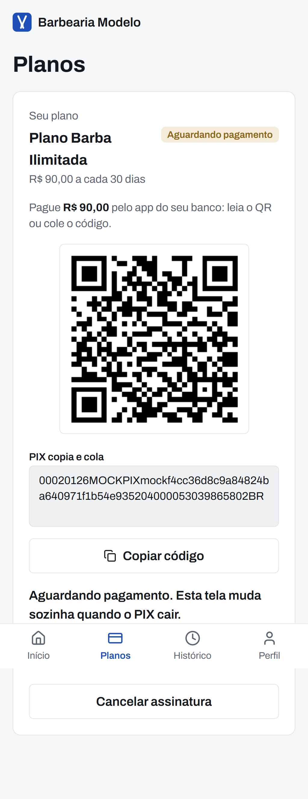
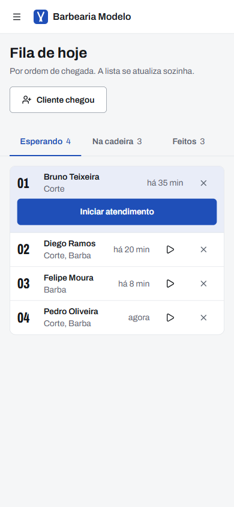

# Vez

Sistema para barbearia que atende por ordem de chegada. O cliente chega, mostra um QR Code no celular e entra na fila. No app ele acompanha a própria vez ("Você é o próximo"). A equipe vê a fila ao vivo, chama o próximo, finaliza o atendimento e vende planos de assinatura pagos por PIX. As conversas de WhatsApp e Instagram caem numa caixa de entrada só. Uma única API atende várias barbearias, cada uma isolada da outra e com a própria cor de marca.

São três apps neste repositório:

| App | Pasta | Para quem | O que tem |
|---|---|---|---|
| API | `apps/api` | todos | NestJS, Prisma, PostgreSQL, Redis com BullMQ e Socket.IO. Toda a regra de negócio mora aqui. |
| Painel | `apps/painel` | dono, gerente e barbeiro | Fila de hoje, clientes, planos, assinaturas, financeiro, dashboard, caixa de entrada, check-in, equipe e configurações. |
| Cliente | `apps/cliente` | cliente da barbearia | Posição na fila, QR de entrada, planos com PIX, histórico, perfil e recuperação de senha. |

## Telas

Fila de hoje no painel: quem espera, quem está na cadeira e o que já foi feito, com o total do dia.



<table>
<tr>
<td></td>
<td></td>
<td></td>
</tr>
</table>

Os prints das telas, em celular e desktop, ficam em `docs/prints/painel` e `docs/prints/cliente`.

## Como rodar

Precisa só de Docker com o Compose 2.24 ou mais novo.

```bash
git clone https://github.com/hugh514/barbearia.git && cd barbearia
cp .env.example .env
docker compose up --build
```

Na primeira vez demora alguns minutos para montar as imagens. O compose sobe Postgres e Redis, aplica as migrations, roda o seed com dados de exemplo e só então libera o painel e o cliente.

| O quê | Endereço |
|---|---|
| Painel | http://localhost:3001 |
| Cliente | http://localhost:3002 |
| API | http://localhost:3000 (saúde em `/health`, Swagger em `/docs`) |
| Postgres | localhost:5433, usuário e senha `barber` |

Para parar: `docker compose down`. Para zerar o banco também: `docker compose down -v`.

## Login de teste

Essas senhas existem só no seed, para ambiente local. Não use em produção.

| Onde | E-mail | Senha |
|---|---|---|
| Painel, dono da Barbearia Modelo | admin@barbearia.example | admin123 |
| Painel, gerente | gerente@barbearia.example | admin123 |
| Painel, barbeiros | barbeiro@, rafael@ ou lucas@barbearia.example | admin123 |
| Painel, dono da Barbearia do Centro | dono@centro.example | admin123 |
| Painel, dono da Navalha Norte | dono@navalha.example | admin123 |
| App do cliente | cliente@barbearia.example | Cliente123 |

O seed cria três barbearias. A Barbearia Modelo é a mais completa: dono, gerente, três barbeiros, clientes, fila do dia com gente esperando, na cadeira, finalizada e cancelada, planos, assinaturas em todos os status, pagamentos e conversas. As outras duas têm equipe, clientes, planos e fila menores. Nomes, telefones e e-mails são inventados.

A fila do dia fica com a data em que o banco foi criado. Para ter a fila de novo no dia de hoje, rode `docker compose down -v` e suba outra vez.

## O que dá para testar sem nenhuma chave

O `.env.example` não tem nenhuma chave real, e o sistema funciona inteiro em modo local:

- **PIX**: com o token falso do `.env.example`, a API usa um provedor de teste (`PAYMENTS_PROVIDER` vazio escolhe sozinho; `mock` força). O QR e o copia e cola aparecem normalmente, e no app do cliente o botão "Simular pagamento (dev)" aprova a cobrança. Para usar o Mercado Pago de verdade, ponha um token de sandbox seu (`TEST-...`) em `MERCADO_PAGO_ACCESS_TOKEN`.
- **E-mail de recuperação de senha**: com `EMAIL_PROVIDER=log` (o padrão), a API não envia nada e registra no log só que o e-mail saiu, sem o link. Em produção a API exige um provedor real e não sobe com `log`. O envio por SMTP ainda não foi implementado, então hoje a API não sobe em produção até ele existir.
- **WhatsApp** (Evolution API): sem `EVOLUTION_API_KEY` a API recusa os webhooks e não envia nada.
- **Instagram**: sem `INSTAGRAM_PAGE_ACCESS_TOKEN` nada é enviado.
- **IA** (OpenAI): sem `OPENAI_API_KEY` fica desligada.

Os segredos de webhook do `.env.example` são públicos e servem só para testar localmente. A API recusa subir em produção com esses valores padrão.

## Configuração que importa fora do local

| Variável | Onde | Para quê |
|---|---|---|
| `APP_TZ` | compose (API e painel) | Fuso do "hoje" da fila e do dashboard. Padrão `America/Sao_Paulo`. |
| `COOKIE_SECURE` | painel e cliente | Com `NODE_ENV=production` os cookies de sessão são `Secure` e só funcionam em https. O compose roda em http e usa `false`. Só o valor `false`, escrito assim, desliga. Nunca use num ambiente com https. |
| `TRUST_PROXY` | API | Quantos proxies confiáveis estão na frente da API (`false` ou um número). Obrigatório em produção; `true` é recusado. |
| `FORWARD_CLIENT_IP` | painel e cliente | Repassa o IP de quem acessa para a API, para o limite de tentativas valer por pessoa. Só ligue com um proxy na frente que sobrescreva o `X-Forwarded-For`; sem ele o IP é forjável. Padrão desligado. |
| `PAINEL_PUBLIC_URL`, `CLIENTE_PUBLIC_URL` | API | Endereço público de cada front, usado no link do e-mail de nova senha. Em produção precisa ser https. |
| `DEFAULT_TENANT_SLUG` | cliente | Barbearia usada no cadastro quando o link não traz `?b=`. Padrão `barbearia-modelo`. |

## Testes e CI

Cada app tem os próprios testes. Dentro da pasta do app: `npm test` para os unitários e `npm run test:e2e` para os e2e (na API, com o banco migrado, o seed rodado e o Redis no ar).

- **API**: unitários (Jest) e e2e contra Postgres e Redis de verdade.
- **Painel e cliente**: unitários (Vitest) e fluxos de tela com Playwright.
- **Fumaça**: com o compose no ar, `bash scripts/testar-api.sh` percorre login, clientes, fila, atendimento, planos, papéis e isolamento entre barbearias.

O GitHub Actions (`.github/workflows/ci.yml`) roda lint, tipos, testes e build de cada app que mudou, e os e2e da API com banco. A `main` só recebe mudança por PR, e o merge exige o check `ci` verde com a branch atualizada.

## Estrutura

```text
barbearia/
  .github/workflows/ci.yml   CI por app
  apps/
    api/        API NestJS (prisma/, src/, test/, specs/)
    painel/     painel da equipe (src/, e2e/, specs/)
    cliente/    app do cliente (src/, e2e/)
  docs/
    constituicao/   princípios da API e do painel
    design.md       identidade visual: cor por barbearia, tipografia, telas
    prints/         prints das telas
  scripts/
    testar-api.sh   teste de fumaça da API
  docker-compose.yml
  .env.example
  AGENTS.md         regras para quem (pessoa ou agente) for mexer no código
```

Cada app tem o próprio `package.json` e `package-lock.json`. Não há workspaces: para trabalhar num app, entre na pasta dele e use `npm install` e os scripts de lá.

## Decisões principais

- **Ordem de chegada, sem agendamento.** A fila é a lista de atendimentos em espera, em ordem de chegada. O bot informa e direciona, mas não marca horário.
- **Várias barbearias numa API (multi-tenant).** Toda tabela tem `tenant_id`, toda consulta filtra por ele e o tenant vem do token. Vazar dado de uma barbearia para outra é tratado como falha de segurança.
- **A API é o centro.** Painel, cliente, WhatsApp, Instagram e IA só falam com a API. Ninguém acessa o banco além dela.
- **Efeito colateral vai para fila.** Mensagem pós-atendimento, pedido de avaliação e confirmação de pagamento rodam em jobs do BullMQ, com retry, e nunca travam a requisição.
- **Check-in por QR Code de vida curta.** O cliente gera um token opaco que vale 60 segundos; a equipe lê e o cliente entra na fila. Gerar um novo invalida o anterior.
- **Pagamento pelo gateway.** A API cria a cobrança e confirma por webhook com assinatura validada e processamento idempotente. Cartão nunca passa pela API.
- **Sessão em cookie httpOnly.** O navegador fala só com as rotas `/api/*` do próprio Next, que repassam para a API. A exceção é o tempo real do painel: `/api/realtime/token` entrega o token ao JavaScript e o navegador conecta direto na API (Socket.IO) em `API_PUBLIC_URL`.
- **Redirecionamento só interno.** O `?from=` do login aceita apenas caminho do próprio app, inclusive depois de resolver `..` e `%2e`.
- **Cor da barbearia.** Cada barbearia escolhe a cor de marca e o modo claro ou escuro em Configurações, Aparência. Os tons derivados são calculados com contraste mínimo garantido. A última aparência fica num cookie (`bb_theme` no painel, `bc_theme` no cliente) para quando a API não responde.

Os detalhes estão em `docs/design.md`, em `docs/constituicao/` e nas specs de cada app.
